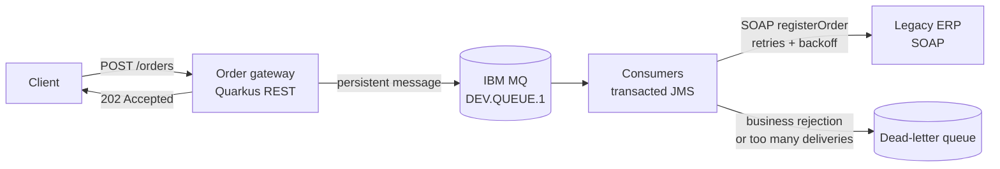

# Reliable ERP integration with Quarkus, IBM MQ and SOAP

[](https://github.com/juancfajardo/quarkus-ibm-mq-soap-integration/actions/workflows/integration.yml)

A Quarkus service that takes orders over REST and delivers them to a legacy ERP over SOAP, through IBM MQ. It is tested against an ERP mock that is deliberately unreliable: it fails part of the calls, it is slow, and sometimes it saves the order and then loses the reply. The same orders are also sent with a direct SOAP call, for comparison.

> **Status:** code, CI and load test are in place. The measured results are published here once the integration workflow has run.

## The problem

Many companies still put orders into an ERP through a SOAP service that was never designed for modern traffic. When the client calls it directly:

- Every time the ERP is down or slow, the order fails for the user and has to be retried by hand.
- If the ERP saves the order but the reply is lost on the way back, the client sees an error for an order that exists. A manual retry then creates a **duplicate**.
- The client waits for the ERP on every request, so the API is as slow as the ERP.

## The design



| Decision | Why |
|---|---|
| The API answers `202 Accepted` after the message is persisted in IBM MQ | The client never waits for the ERP, and no order is lost if the ERP is down: it waits in the queue |
| Consumers use a **transacted** JMS session | The message is removed from the queue only when the ERP has answered. If the gateway dies mid-call, IBM MQ delivers the message again |
| The order id travels to the ERP as an **idempotency key** | Retrying is safe: when a reply was lost after saving, the retry returns the existing ERP number instead of creating a duplicate |
| Technical errors are retried with **exponential backoff**; after the retries the transaction rolls back | Short outages are absorbed in place; longer ones are handled by IBM MQ redelivery |
| Business rejections and messages delivered too many times go to the **dead-letter queue**, in the same transaction | Bad orders do not block the queue and are kept for review, with the reason attached |
| Contract-first SOAP client generated by Quarkus CXF from a shared interface | Server and client cannot drift apart |

## Results

*Pending the first run of the integration workflow.*

## Project layout

```
erp-contract/      shared JAX-WS service interface and messages
legacy-erp-mock/   Quarkus CXF SOAP service with fault injection (failure rate, lost replies, latency)
order-gateway/     Quarkus REST API, IBM MQ producer and transacted consumers, SOAP client with retries
bench/             load test (Python, standard library) and chart generator
.github/workflows/ CI: build, unit tests, IBM MQ container, load test, results
```

## Run it locally

Requirements: Java 21, Maven, Docker (or Podman) and Python 3.10+.

```bash
docker compose up -d                                   # IBM MQ developer edition, wait until healthy
mvn -B verify                                          # build + unit tests
java -jar legacy-erp-mock/target/quarkus-app/quarkus-run.jar &   # SOAP on :8081
java -jar order-gateway/target/quarkus-app/quarkus-run.jar &     # REST on :8080
python bench/run_load.py                               # both scenarios, writes results/summary.json
pip install matplotlib && python bench/charts.py       # chart, table and cover image
```

Try it by hand:

```bash
curl -s -X POST localhost:8081/erp/config -H 'Content-Type: application/json' \
     -d '{"failureRate":0.3,"lostReplyRate":0.1,"latencyMs":100}'
curl -s -X POST localhost:8080/orders -H 'Content-Type: application/json' \
     -d '{"customerCode":"C00042","totalAmount":125.50,"lineCount":3}'
curl -s localhost:8080/orders/stats
```

## About me

I'm Juan Fajardo, a backend tech lead and architect for Java platforms (Spring Boot, Quarkus), with Oracle and SingleStore in production and ERP and legacy integration over SOAP, IBM MQ and AS400. I build integrations that keep working when the systems around them do not.

Everything in this repository is written from scratch for this demo. No code or data from any employer or client is included.

## License

MIT
